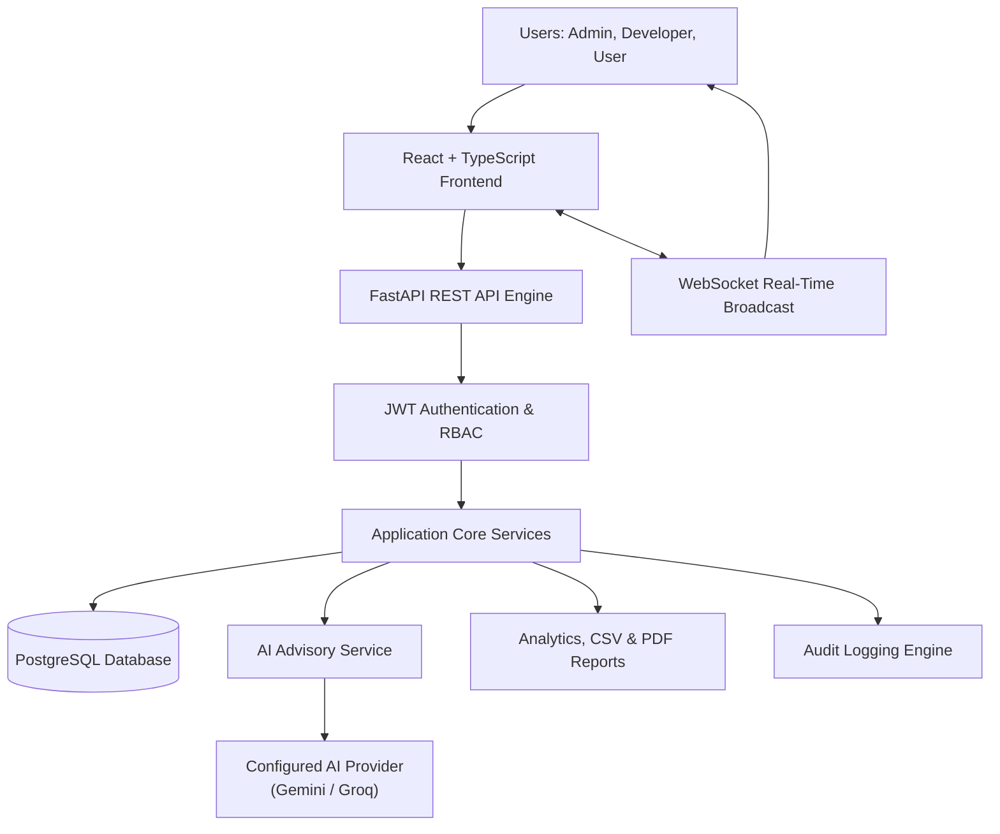
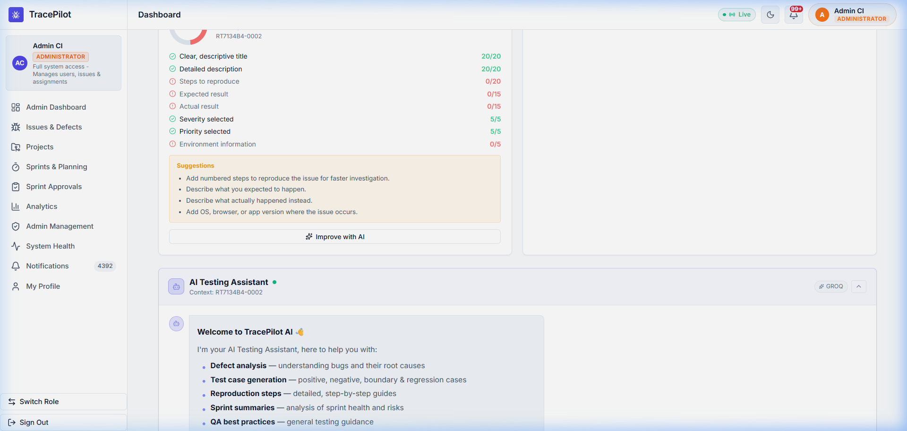
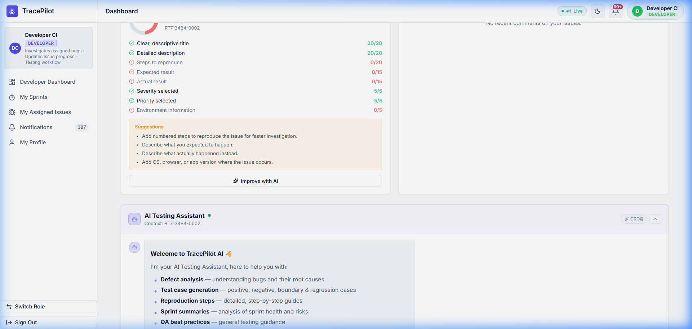
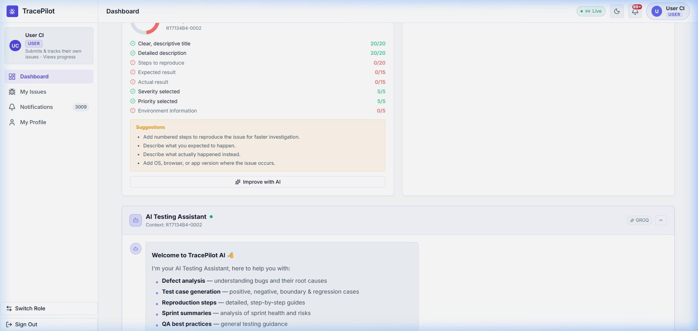
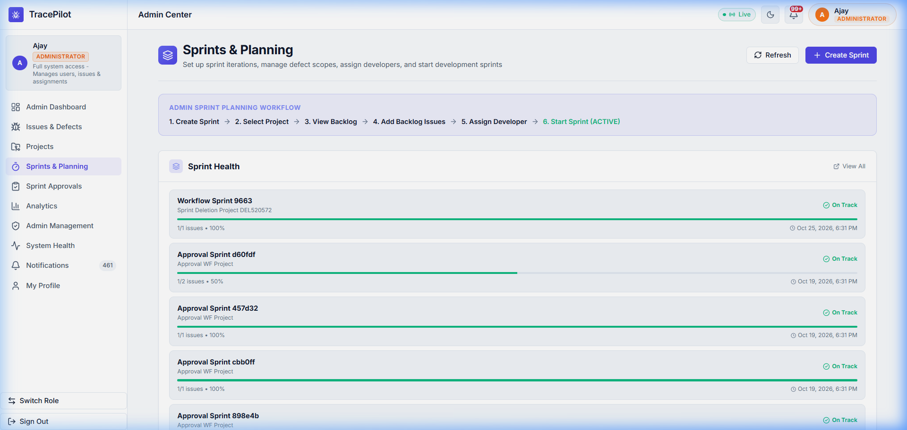
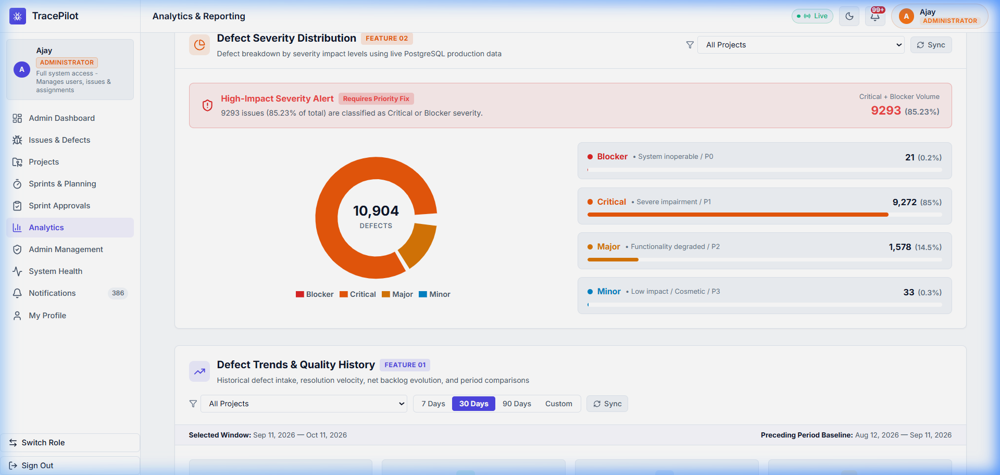
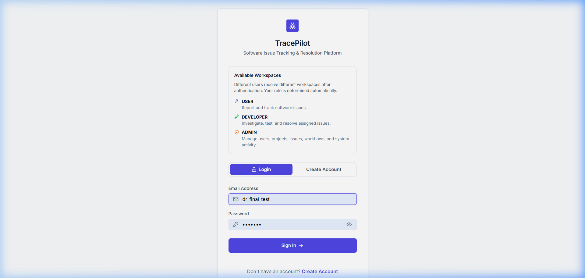
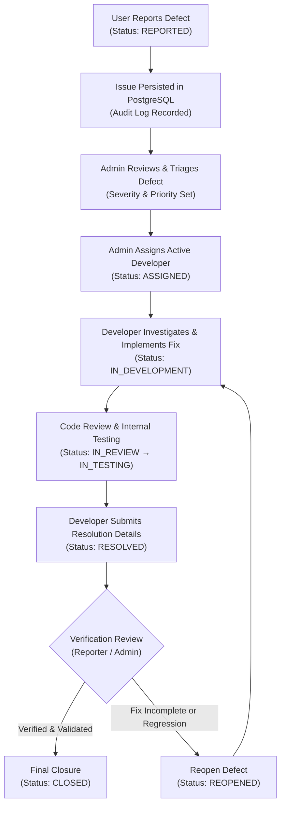
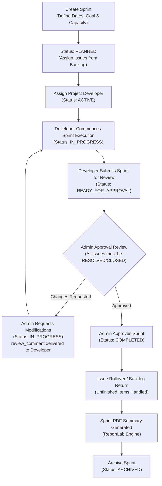
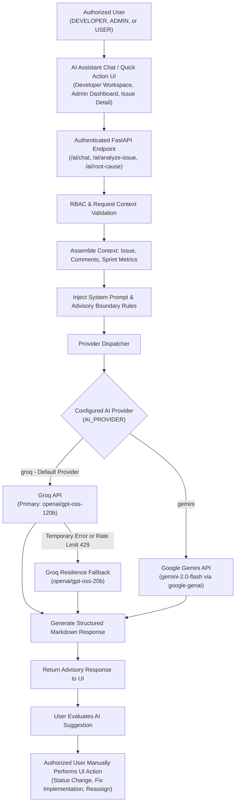

<div align="center">

# 🐞 TracePilot
### Intelligent Software Defect Tracking & Agile Project Management System

<p align="center">
  <strong>Track. Resolve. Deliver.</strong>
</p>

<hr width="80%" />

[](https://www.python.org/)
[](https://fastapi.tiangolo.com/)
[](https://www.postgresql.org/)
[](https://www.sqlalchemy.org/)
[](https://alembic.sqlalchemy.org/)

[](https://react.dev/)
[](https://www.typescriptlang.org/)
[](https://vitejs.dev/)

[](https://jwt.io/)
[](https://developer.mozilla.org/en-US/docs/Web/API/WebSockets_API)
[](https://docs.pytest.org/)
[](https://ai.google.dev/)
[](https://opensource.org/licenses/MIT)

<br/>

**Repository:** [https://github.com/AjayKumarKR07/TracePilot](https://github.com/AjayKumarKR07/TracePilot)  
**Author:** Ajay Kumar K R  
**Architecture:** Full-Stack Enterprise Single-Page Application (FastAPI + React + PostgreSQL)

<p align="center">
  <em>TracePilot is an enterprise-grade automated defect tracking, Agile sprint execution, and software quality assurance system engineered to streamline defect lifecycles, developer workload allocation, real-time collaboration, and advisory AI root-cause diagnostics.</em>
</p>

</div>

---

## 🚀 Version & Tech Stack Summary

| Property                    | Details                                                      |
| --------------------------- | ------------------------------------------------------------ |
| **Current Version**         | `v1.0.0`                                                     |
| **Status**                  | 🟢 Active Development                                        |
| **Backend Framework**       | FastAPI `0.141.1` (Python `3.10+`)                           |
| **Frontend Framework**      | React `18+` + TypeScript `5.7` + Vite `5.4`                  |
| **UI & Styling**            | Vanilla CSS + CSS Design Tokens (dark glassmorphic theme)    |
| **Database**                | PostgreSQL `14+`                                             |
| **ORM & Migrations**        | SQLAlchemy `2.0` (async) + Alembic `1.19.1`                  |
| **Authentication**          | JWT (`httponly` cookies + refresh tokens) + Bcrypt           |
| **Real-Time Communication** | WebSocket (`websockets`) — DB-persisted + broadcast          |
| **Testing Framework**       | Pytest `9.1.1` — **520 passing, 10 skipped**                 |
| **AI Advisory Engine**      | Google Gemini (`gemini-2.0-flash`) & Groq (primary default)  |
| **PDF Reports**             | ReportLab `4.1.0`                                            |
| **License**                 | MIT License                                                  |

---

# 📌 Overview

TracePilot provides a centralized, full-stack platform for managing software development and defect-tracking workflows.

The system provides:

* 🔐 JWT authentication with `httponly` cookie storage and refresh token rotation
* 👥 Role-Based Access Control (RBAC) — three canonical roles: `ADMIN`, `DEVELOPER`, `USER`
* 🐞 Issue and defect tracking with concurrent-safe key generation
* 📁 Project management with unique project-key enforcement
* 🏃 Agile sprint planning with a 6-state FSM lifecycle
* 📋 Backlog management with eligibility filtering (excludes `RESOLVED`/`CLOSED`)
* 📊 Sprint analytics, burndown tracking, and workload analysis
* 🔔 Real-time WebSocket notifications — persisted in PostgreSQL, broadcast on connect
* 📝 Immutable audit logging in the same transaction as every mutating operation
* 💬 Issue comments and threaded discussions
* 📎 File attachments with MIME validation and 413 handling
* 📈 Admin and developer analytics dashboards
* 📑 PDF sprint reports (generated in-memory via ReportLab)
* 🔄 Safe issue rollover and sprint deletion with backlog preservation
* 🔗 GitHub/Webhook integration
* 🤖 **AI Assistant** — Dual-provider Gemini & Groq advisory assistant (strictly read-only)

---

## 🎯 Problem Statement

Modern software engineering teams face critical operational bottlenecks when managing defect lifecycles, team allocation, and sprint commitments across fragmented tooling:

* **Fragmented & Disconnected Tooling:** Software defects, feature requests, and regression bugs are frequently scattered across email threads, issue trackers, and spreadsheets, resulting in lost context, fragmented records, and lack of a single source of truth.
* **Manual & Unbalanced Workload Allocation:** Without automated workload visibility, defect assignment is typically manual, leading to uneven developer workloads, developer burnout, bottlenecked reviews, and delayed issue resolution.
* **Opaque Defect Tracking & Aging:** Engineering leads struggle to continuously monitor defect severity, business priority, backlog aging, and real-time resolution progress, causing high-severity defects to languish unaddressed.
* **Sprint Planning & Rollover Friction:** Agile sprint execution falters when planning occurs without clear insight into team capacity, historical velocity, and unassigned backlog items. Handling unfinished work often leads to orphaned defects or dropped scope.
* **Communication Gaps & Delayed Notifications:** In asynchronous environments, lack of real-time notification broadcasts delays immediate developer responses to urgent defect assignments, status changes, and sprint reviews.
* **Inadequate Auditability & Compliance Gaps:** Regulated and enterprise software teams require strict traceability. Many tracking tools lack immutable audit logging of state transitions, actor accountability, and timestamped resolution events.
* **Laborious Quality & Sprint Reporting:** Manually gathering defect metrics, burndown statistics, and stakeholder PDF reports consumes valuable engineering and project management hours.
* **Uncontrolled AI Integration Risks:** While teams can benefit from AI assistance for defect root-cause analysis, reproduction guidance, and test-case generation, autonomous AI modifications risk corrupting production database records and compromising project state.

> **The Need:** Modern software development organizations require a **centralized, secure, data-driven defect management and Agile execution platform** that integrates end-to-end defect tracking, strict role-based governance, real-time collaboration, automated analytics, and safe, advisory-only AI diagnostics.

---

## 💡 Our Solution — TracePilot

**TracePilot** is a production-grade, full-stack software defect tracking and Agile project management platform engineered to unify defect lifecycles, developer accountability, and sprint execution into a single, cohesive software system.

TracePilot resolves industry challenges through targeted, production-ready capabilities:

* **Centralized Defect Lifecycle Management:** End-to-end defect creation, severity/priority triage, component tagging, reproduction step tracking, and developer assignment with complete resolution verification.
* **Canonical Role-Based Access Control (RBAC):** Strict operational isolation between `ADMIN` (governance, triage, sprint approvals), `DEVELOPER` (defect investigation, code resolution, sprint execution), and `USER` (defect reporting, reproduction clarification, closure verification).
* **Concurrent-Safe Issue Key Generation:** Savepoint-based retry loop (up to 10 attempts) with PostgreSQL SQLSTATE `23505` + constraint-name precision for the `ix_issues_issue_key` uniqueness guard — never retries on unrelated integrity errors.
* **Agile Sprint & Backlog Orchestration:** Project-isolated backlog management (eligibility excludes `RESOLVED`/`CLOSED`), capacity planning, single-active-sprint enforcement per project, and safe rollover of unfinished items upon sprint completion.
* **Controlled Sprint Review & Approval Workflows:** Developers submit completed sprints for administrative review (`READY_FOR_APPROVAL`), allowing administrators to either approve completion or request targeted rework (`IN_PROGRESS`). Approval requires all sprint issues to be `RESOLVED` or `CLOSED`.
* **Deep Quality & Workload Analytics:** Real-time metrics covering defect distribution, severity trends, backlog aging, burndown rates, capacity calculations, and team workload balance.
* **Real-Time WebSocket Broadcasts:** Instantaneous, full-duplex WebSocket notifications alerting team members to defect assignments, status transitions, comments, and sprint lifecycle milestones. Notifications are persisted in PostgreSQL before broadcast — replayed on reconnect.
* **Immutable Audit Trail:** Comprehensive event logging (`audit_logs`) tracking actor IDs, action types, entity references, previous states, and timestamped changes — written in the same database transaction as the triggering operation.
* **Automated Stakeholder Reporting:** On-demand CSV defect exports and programmatic, high-fidelity PDF sprint reports generated via ReportLab, streamed directly to the browser (no server temp files).
* **Advisory AI Assistant (Gemini & Groq):** Deep defect analysis, root-cause investigation, reproduction guides, test-case generation, and sprint health summaries powered by Google Gemini (via `google-genai`) with automated Groq fallback.
* **Enterprise Full-Stack Architecture:** Persistent PostgreSQL database with async SQLAlchemy 2.0 ORM and Alembic migrations, asynchronous FastAPI REST APIs, and a modern, high-performance React + TypeScript frontend.

> 🔒 **Advisory AI Guarantee:** TracePilot AI operates **strictly as an advisory assistant**. It never executes database modifications, assigns tasks, or changes defect states autonomously. All workflow progressions require deliberate, authenticated user operations through authorized application endpoints.

### Key Outcomes
* **Improved Visibility:** Real-time visibility into project backlogs, defect velocity, and team throughput across all projects.
* **Consistent Workflows:** Standardized defect triage, structured review gates, and formal sprint approval processes.
* **Better Prioritization:** Data-driven severity and priority matrices ensure critical and blocker defects receive immediate attention.
* **End-to-End Traceability:** Complete audit logs record every state transition, assignment change, and approval decision.
* **Data-Driven Decisions:** Live burndown curves, workload distribution charts, and PDF summaries eliminate guesswork from sprint management.

---

# 🏛️ Architecture & System Workflows

### System Architecture

TracePilot is architected as an enterprise-tier single-page application (SPA) backed by asynchronous Python services and PostgreSQL persistence:



---

# 🖼️ Application Interfaces & Visual Showcase

TracePilot provides unified, modern, dark glassmorphic workspaces tailored for each canonical role:

### 1. 🛡️ Admin Command Center & Governance (`/admin-dashboard`)
Comprehensive system management including user account activation/deactivation, role modifications, project creation, defect assignment triage matrix, sprint approvals, and live health telemetry.

<p align="center">
  
</p>

---

### 2. 👨‍💻 Developer Workspace & Testing Queue (`/developer-dashboard`)
Dedicated engineering hub for assigned defects, active sprint execution, testing validation queue (`IN_TESTING` → `RESOLVED`), and developer work health metrics.

<p align="center">
  
</p>

---

### 3. 👤 User Defect Tracking & Verification Portal (`/user-dashboard`)
Reporter portal enabling defect creation with repro steps, real-time status tracking, resolution verification, and one-click defect closure or reopening.

<p align="center">
  
</p>

---

### 4. 🏃 Agile Sprints & Backlog Planning (`/sprints`)
Structured sprint iteration authoring, capacity allocation, active sprint lifecycle management, and backlog prioritization with eligibility filtering.

<p align="center">
  
</p>

---

### 5. 📈 Quality Intelligence & Analytics Dashboard (`/analytics`)
Live analytical insights powered by Plotly.js covering defect severity distributions, velocity trends, team workload balance, and PDF report downloads.

<p align="center">
  
</p>

---

### 6. 🔐 Secure Authentication & Onboarding (`/login`)
JWT-secured entry point featuring bcrypt credential validation, OTP email verification flow, and automatic role-based redirecting.

<p align="center">
  
</p>

---

## 🔄 Defect Lifecycle

TracePilot enforces a rigorous, state-controlled defect lifecycle ensuring accountability at every transition from initial submission through verification and closure:



### Defect Lifecycle Roles & Permissions
* **USER (Reporter):** Submits defect reports with environment, expected result, actual result, and reproduction steps. Conducts final acceptance testing and verification on resolved defects before closure.
* **ADMIN:** Reviews reported defects, sets priority and severity classifications, manages backlog queues, assigns active Developers, and monitors resolution SLAs.
* **DEVELOPER:** Investigates root causes, transitions defects through development stages (`IN_DEVELOPMENT` → `IN_REVIEW` → `IN_TESTING`), writes code fixes, and submits structured resolution summaries (`RESOLVED`).

---

## 🏃 Sprint Management Workflow

Agile iterations in TracePilot follow a structured, 6-state lifecycle governed by project capacity, single-active-sprint rules, and a formal approval gate:



### Sprint State Machine — Quick Reference

| Transition | Actor | From → To |
|---|---|---|
| Assign Developer | `ADMIN` | `PLANNED` → `ACTIVE` |
| Begin Work | `DEVELOPER` / `ADMIN` | `ACTIVE` → `IN_PROGRESS` |
| Submit for Approval | `DEVELOPER` / `ADMIN` | `IN_PROGRESS` → `READY_FOR_APPROVAL` |
| Approve | `ADMIN` | `READY_FOR_APPROVAL` → `COMPLETED` |
| Request Changes | `ADMIN` | `READY_FOR_APPROVAL` → `IN_PROGRESS` |
| Archive | `ADMIN` | `COMPLETED` → `ARCHIVED` |

### Core Sprint Rules & Safeguards
* **Single Active Sprint Rule:** Only **one sprint can be in execution (`ACTIVE`, `IN_PROGRESS`, or `READY_FOR_APPROVAL`) per project at any given time**, preventing team scope dilution.
* **Approval Guard:** Admin approval fails if any sprint issue is still open (not `RESOLVED` or `CLOSED`) — enforced at the service layer.
* **Review Comment Delivery:** When admin requests changes, the `review_comment` is persisted to the sprint and a WebSocket notification is sent directly to the assigned developer.
* **Dual-Sync Developer Assignment:** Sprint assignments use the canonical `assigned_developer_id` column with automatic PostgreSQL trigger synchronization (`trg_sync_sprint_developer_assignee`) for legacy column compatibility.
* **Safe Issue Rollover:** When a sprint is completed, any unfinished defects are protected against data loss and can be automatically migrated to the next planned sprint or returned safely to the unassigned backlog.
* **Capacity Planning Engine:** Calculates available team hours (`team_members × working_days × hours_per_day`) to ensure assigned issue story points do not exceed capacity.

---

## 🔑 Concurrent-Safe Issue Key Generation

Issue keys (e.g., `PROJ-42`) are generated atomically using a **savepoint-based retry loop**:

1. A candidate key is generated from the project key + next sequence number, tracking all `attempted_keys` to avoid re-trying the same value.
2. The insert is wrapped in a **PostgreSQL savepoint** so a uniqueness conflict rolls back only that attempt, not the outer transaction.
3. On conflict, the savepoint is rolled back and a new key is generated — up to `MAX_RETRIES = 10` **total attempts**.
4. Conflict detection uses structured PostgreSQL diagnostics: **SQLSTATE `23505`** + **`diag.constraint_name == "ix_issues_issue_key"`** — only the issue-key uniqueness constraint triggers a retry; unrelated integrity errors are re-raised immediately.
5. If all 10 attempts fail, the endpoint returns HTTP `409 Conflict` with a clear error message — never an unexpected HTTP 500.
6. Audit logs and notifications execute **exactly once**, only after the issue is successfully created.

---

## 🤖 AI Advisory Workflow

TracePilot embeds an advisory AI assistant into Developer and Admin dashboards to accelerate defect diagnosis and sprint quality without sacrificing data integrity:



### Advisory Integrity & Provider Guarantees
* **Strict Advisory Isolation:** The AI service is strictly read-only with respect to project records. It cannot modify defect statuses, reassign users, close sprints, or alter database entities. All actions must be performed manually through the TracePilot UI by authorized personnel.
* **Dynamic Provider Routing & Resilience:** TracePilot supports **Groq** (production default with automated model fallback) and **Google Gemini** (via `google-genai` SDK). When using Groq, if the primary model (`openai/gpt-oss-120b`) encounters temporary errors, the engine automatically falls back to `openai/gpt-oss-20b` without interrupting user workflows.
* **Sanitized Logs & Credential Protection:** All credentials, API keys, and sensitive environment variables are strictly filtered, masked, and excluded from application logs, error traces, and client responses.

---

# 🤖 AI Assistant Configuration & Endpoints

TracePilot includes a built-in advisory AI Assistant supporting **Groq** (production default with automatic fallback) and **Google Gemini** (via `google-genai`).

## What it does

| Feature | Description |
|---|---|
| **General Chat** | Technical advisory answering defect, architecture, and testing queries in clean markdown |
| **Defect Analysis** | Full structured analysis: probable root causes, test scenarios, and edge cases |
| **Test Case Generation** | Positive, negative, boundary, validation, and regression test cases |
| **Reproduction Steps** | Detailed, step-by-step reproduction and isolation guides with preconditions and evidence collection |
| **Root Cause Analysis** | Advisory investigation with layered architectural hypotheses (distinguishes facts from inferences) |
| **Sprint Summary** | AI analysis of sprint velocity, completion status, bottleneck risks, and resolution focus areas |
| **Explain Metrics** | Plain-language explanation of TracePilot sprint & defect analytics |
| **Quick Actions** | One-click prompt templates contextualized with current issue or sprint data |

> **Advisory-Only Guarantee:** The AI assistant is strictly advisory and never modifies database records. All suggestions, fixes, and workflow transitions must be executed manually through the TracePilot UI by the appropriate team member.

## Available Interfaces

The AI Assistant is natively embedded across key TracePilot workspaces:
* **Developer Workspace (`/developer-dashboard`):** Real-time interactive AI chat drawer and triage assistant for defect investigation, reproduction guidance, and root cause analysis.
* **Admin Dashboard (`/admin-dashboard`):** Executive AI assistance for sprint summaries, bottleneck detection, and analytics metric interpretation.
* **Defect Detail View (`/issues/:id`):** One-click contextual AI quick actions to generate structured test cases, analyze stack traces, or generate reproduction guides directly from the active defect record.

## Setup & Provider Configuration

Configure your AI settings in `backend/.env`. TracePilot provides production-grade resilience with multi-model fallback:

```env
AI_ENABLED=true
AI_PROVIDER=groq                    # 'groq' (default production provider) or 'gemini'
AI_MODEL=openai/gpt-oss-120b        # Default model name
MAX_MESSAGE_LENGTH=4000             # Maximum user input character limit

# Groq Configuration (Primary production provider with automatic model fallback)
GROQ_API_KEY=your-groq-key-here
GROQ_MODEL=openai/gpt-oss-120b
GROQ_FALLBACK_MODEL=openai/gpt-oss-20b

# Google Gemini Configuration (Alternative provider via google-genai SDK)
GEMINI_API_KEY=your-gemini-key-here
```

Restart the backend server after updating `.env`. The AI assistant will automatically activate in the corresponding dashboards.

> ⚠️ **Security**: Never commit API keys to version control. Keys are protected via `.env` in `.gitignore`.

## AI API Endpoints

| Method | Endpoint | Description | Permitted Roles |
|---|---|---|---|
| `GET` | `/ai/health` | Service availability check & provider status | Authenticated Users |
| `POST` | `/ai/chat` | General chat with optional issue/sprint context | `ADMIN`, `DEVELOPER`, `USER` |
| `POST` | `/ai/analyze-issue` | Structured defect analysis | `ADMIN`, `DEVELOPER`, `USER` |
| `POST` | `/ai/generate-test-cases` | Structured test cases | `ADMIN`, `DEVELOPER`, `USER` |
| `POST` | `/ai/reproduction-steps` | Detailed reproduction guide | `ADMIN`, `DEVELOPER`, `USER` |
| `POST` | `/ai/root-cause` | Root cause analysis | `ADMIN`, `DEVELOPER`, `USER` |
| `POST` | `/ai/sprint-summary` | Sprint health analysis | `ADMIN`, `DEVELOPER`, `USER` |
| `POST` | `/ai/explain-metrics` | Metrics explanation | `ADMIN`, `DEVELOPER`, `USER` |

> **Advisory-Only Guarantee:** All `/ai/*` endpoints are strictly advisory and read-only with respect to database state. No AI response can independently create, mutate, transition, or delete issues, projects, users, or sprint records.

---

# 👥 Supported Roles

TracePilot operates strictly on three canonical application roles:

| Role        | Access & Responsibilities                                                                      |
| ----------- | ---------------------------------------------------------------------------------------------- |
| `ADMIN`     | System administration, user governance, project management, sprint approvals, defect triaging, developer workload distribution, and audit access |
| `DEVELOPER` | Defect investigation, root-cause resolution, code fix implementation, test execution and verification, sprint delivery, and completion submission |
| `USER`      | Standard authenticated portal access, defect reporting, reproduction clarification, and post-resolution acceptance verification   |

### Role Permissions Matrix

| Action | ADMIN | DEVELOPER | USER |
|---|:---:|:---:|:---:|
| Create/manage projects | ✅ | ❌ | ❌ |
| Manage users & roles | ✅ | ❌ | ❌ |
| Triage & assign issues | ✅ | ❌ | ❌ |
| Create & configure sprints | ✅ | ❌ | ❌ |
| Assign developer to sprint | ✅ | ❌ | ❌ |
| Approve / request changes on sprint | ✅ | ❌ | ❌ |
| Begin sprint work | ✅ | ✅ | ❌ |
| Submit sprint for approval | ✅ | ✅ | ❌ |
| View assigned sprints & issues | ✅ | ✅ | ❌ |
| Report defects | ✅ | ✅ | ✅ |
| View own issues | ✅ | ✅ | ✅ |
| Close / verify resolved defects | ✅ | ✅ | ✅ |
| Access AI assistant | ✅ | ✅ | ✅ |
| View analytics | ✅ | ✅ | ❌ |
| Download PDF sprint reports | ✅ | ✅ | ❌ |
| Access audit logs | ✅ | ❌ | ❌ |

---

## 🗄️ Legacy Database Compatibility

TracePilot maintains explicit database-level backward compatibility for existing datasets and historical migrations while strictly enforcing the canonical three-role architecture (`ADMIN`, `DEVELOPER`, `USER`) in all application logic and user interfaces.

The following elements exist strictly as legacy database compatibility mechanisms and are **not** canonical application roles:

* **PostgreSQL Enum Value (`TESTER`):** The underlying PostgreSQL `userrole` enum retains `'TESTER'` alongside `'ADMIN'`, `'USER'`, and `'DEVELOPER'`. The application uses SQLAlchemy's `SafeUserRoleType` decorator to transparently deserialize legacy `'TESTER'` database records as canonical `DEVELOPER` objects, ensuring zero runtime disruption while writing all new records as `DEVELOPER`.
* **Legacy Database Column (`assigned_tester_id`):** The `sprints` table retains the historical column `assigned_tester_id` alongside the canonical `assigned_developer_id` foreign key referencing `users(id)`.
* **Bidirectional Database Trigger (`trg_sync_sprint_developer_assignee`):** A PostgreSQL PL/pgSQL trigger function (`fn_sync_sprint_developer_assignee()`) executes `BEFORE INSERT OR UPDATE ON sprints`, keeping `assigned_developer_id` and `assigned_tester_id` fully synchronized bidirectionally.
* **Audit Action Enum (`SPRINT_TESTER_ASSIGNED`):** Preserved in the `AuditAction` enum to retain historical audit trail fidelity for records logged prior to the canonical developer migration. Active sprint assignments log `SPRINT_DEVELOPER_ASSIGNED`.
* **Frontend Route Backward Compatibility:** Legacy URL routes (`/tester-dashboard`, `/tester-sprints`, `/tester-issues`) are routed via HTTP redirects to their canonical developer counterparts (`/developer-dashboard`, `/developer-sprints`, `/developer-issues`).

---

# 🔐 Authentication & Security

TracePilot provides secure authentication and authorization mechanisms.

### Features

* JWT-based authentication stored in `httponly` cookies (not `localStorage`) to prevent XSS token theft
* Automatic refresh-token rotation for seamless session continuity
* Secure bcrypt password hashing
* Role-Based Access Control (RBAC) with `require_role()` dependency on every sensitive route
* Protected API routes with dependency-based authorization
* Token-based authenticated WebSocket connections
* Secure environment configuration — all secrets via `.env`, never committed

### Authentication Flow

```text
User
 │
 ▼
Login / Registration
 │
 ▼
bcrypt Credential Validation
 │
 ▼
JWT Access Token (httponly cookie) + Refresh Token
 │
 ▼
Protected API Request
 │
 ▼
require_role() Dependency Check
 │
 ├── ADMIN
 ├── DEVELOPER
 └── USER
```

---

# 🐞 Issue & Defect Management

TracePilot supports the complete software defect management lifecycle.

### Features

* Create issues with concurrent-safe key generation (savepoint retry, `MAX_RETRIES=10`)
* Update issues (title, description, severity, priority, type, environment, story points)
* Assign issues to developers
* Track issue status through full FSM
* Set priority and severity
* Add reproduction steps and environment details
* Track reporters and developer assignees
* Estimate effort (story points)
* Search, filter, and sort issues
* Bulk issue operations
* Assign issues to sprints
* Return issues to backlog
* Track resolution timestamps
* Add threaded comments
* Attach files with MIME validation
* Maintain complete issue history via audit logs

### Issue Status FSM

```text
REPORTED → ASSIGNED → IN_DEVELOPMENT → IN_REVIEW → IN_TESTING → RESOLVED → CLOSED
                                                                      ↑
                                                              REOPENED ←
```

### Backlog Eligibility

The project backlog includes only issues that are:
- Not assigned to any sprint (`sprint_id IS NULL`)
- **Not** in terminal states: `RESOLVED` or `CLOSED`

This prevents already-resolved issues from appearing in the backlog and being re-assigned to new sprints.

---

# 📁 Project Management

Projects provide the primary workspace for organizing development activities.

### Features

* Create projects with unique project keys
* Update project information
* Manage project members
* Track project issues
* Manage project sprints
* Project-level analytics
* Project backlog management
* Sprint summaries
* Team workload analysis
* `is_test` tagging for test/demo projects
* Flagship project prioritization in project lists

Each project maintains:

```text
PROJECT
 ├── Members
 ├── Issues (with backlog eligibility filtering)
 ├── Backlog
 ├── Sprints (one active at a time)
 ├── Analytics
 └── Workload Data
```

---

# 🏃 Advanced Sprint Management

TracePilot provides a controlled Agile sprint lifecycle with a formal 6-state FSM.

## Sprint Lifecycle

```text
PLANNED
   │
   ▼ (assign-developer → ADMIN)
ACTIVE
   │
   ▼ (begin-work → DEVELOPER/ADMIN)
IN_PROGRESS
   │
   ▼ (submit-for-approval → DEVELOPER/ADMIN)
READY_FOR_APPROVAL
   │
   ├──────────────► request-changes (ADMIN) ──► IN_PROGRESS
   │
   ▼ (approve → ADMIN, all issues RESOLVED/CLOSED)
COMPLETED
   │
   ▼ (archive → ADMIN)
ARCHIVED
```

### Sprint Operations

* Create sprint (with dates, goal, capacity)
* Update sprint properties
* Assign developer (triggers `PLANNED` → `ACTIVE`)
* Begin sprint work (`ACTIVE` → `IN_PROGRESS`)
* Submit sprint for approval (`IN_PROGRESS` → `READY_FOR_APPROVAL`)
* Approve sprint (`READY_FOR_APPROVAL` → `COMPLETED`)
* Request changes with review comment (`READY_FOR_APPROVAL` → `IN_PROGRESS`)
* Extend sprint end date
* Archive completed sprint (`COMPLETED` → `ARCHIVED`)
* Safely delete eligible sprints (issues returned to backlog)
* Assign/remove individual issues
* Bulk assign backlog issues
* Rollover unfinished issues to backlog or next sprint

---

# 🟢 Single Active Sprint Rule

TracePilot enforces a project-level rule:

> **Only one sprint can be actively executed for a project at a time.**

Statuses `ACTIVE`, `IN_PROGRESS`, and `READY_FOR_APPROVAL` are all considered "in execution." Attempting to start or activate a second sprint while one is already in execution returns HTTP `409 Conflict`.

This prevents overlapping sprint execution cycles and maintains consistent Agile workflow management.

---

# 📋 Advanced Backlog Management

The project backlog contains issues that are eligible for sprint assignment.

### Features

* Backlog eligibility filtering (excludes `RESOLVED`/`CLOSED` and issues already in a sprint)
* Text search across title and description
* Status, priority, severity, and issue type filtering
* Sorting by priority, severity, age, and estimated effort
* Recommended priority ordering (Blocker > Critical > Major > Minor)
* Backlog aging indicators
* Bulk issue selection and sprint assignment
* Estimated effort visibility

### Priority Recommendation

Backlog prioritization considers:

* Severity (BLOCKER, CRITICAL, MAJOR, MINOR, TRIVIAL)
* Priority (CRITICAL, HIGH, MEDIUM, LOW)
* Issue age (creation timestamp)
* Resolution urgency

---

# 📊 Sprint Analytics

Sprint analytics are calculated from actual database data.

### Analytics Include

* Total issues, completed issues, remaining issues
* Completion percentage
* Sprint health (ON_TRACK / AT_RISK / OFF_TRACK)
* Sprint overdue status and days remaining/overdue
* Team workload distribution
* Capacity hours, estimated effort
* Burndown data (ideal vs. actual remaining work)

---

# 🏥 Sprint Health

Sprint health is dynamically calculated based on sprint progress.

| Status         | Meaning                                      |
| -------------- | -------------------------------------------- |
| 🟢 `ON_TRACK`  | Sprint progress is meeting expected progress |
| 🟡 `AT_RISK`   | Sprint progress is behind expected progress  |
| 🔴 `OFF_TRACK` | Sprint is significantly behind or overdue    |

The calculation considers: sprint duration, elapsed time, completion percentage, remaining issues, and overdue status.

---

# 📉 Sprint Burndown

TracePilot generates burndown information from actual issue completion history.

The system compares:

* **Ideal Remaining Work**
* **Actual Remaining Work**

```text
Remaining Work
10 ┤●
 9 ┤ ╲
 8 ┤  ●
 7 ┤   ╲
 6 ┤    ●
 5 ┤     ╲
 4 ┤      ●
 3 ┤       ╲
 2 ┤        ●
 1 ┤         ●
 0 ┼──────────────
     Day 1 → Day 10
```

The system does **not generate fake historical data** when sufficient completion history is unavailable. Instead, the API returns an appropriate empty state.

---

# ⚖️ Capacity Planning

Sprint capacity is calculated using:

```text
Total Capacity Hours = Team Members × Working Days × Hours Per Day

Example: 5 members × 10 days × 6 hrs/day = 300 Capacity Hours
```

Capacity is maintained separately from issue count and estimated effort, allowing realistic sprint loading decisions.

---

# 👥 Workload Analysis

TracePilot calculates workload distribution across team members.

| Team Member  | Assigned Issues |
| ------------ | --------------: |
| Developer A  |               8 |
| Developer B  |               6 |
| Developer C  |               5 |
| Unassigned   |               2 |

This helps administrators understand workload distribution during sprint planning.

---

# 🔄 Safe Issue Rollover

TracePilot prevents unfinished issues from being lost when a sprint is completed.

### Return to Backlog

```text
CURRENT SPRINT → COMPLETE → UNFINISHED ISSUES → PROJECT BACKLOG
```

### Move to Another Sprint

```text
CURRENT SPRINT → COMPLETE → UNFINISHED ISSUES → NEXT SPRINT
```

The system preserves: issue information, comments, attachments, status, resolution information, audit history, and project relationship.

---

# 🗑️ Safe Sprint Deletion

TracePilot protects active workflow data.

Sprints involved in active execution or approval workflows (`ACTIVE`, `IN_PROGRESS`, `READY_FOR_APPROVAL`) cannot be arbitrarily deleted.

Eligible `PLANNED` or `COMPLETED`/`ARCHIVED` sprints can be safely deleted. Before deletion, linked issues are detached from the sprint (their `sprint_id` set to `NULL`) instead of being deleted — preventing accidental issue data loss.

---

# 🔔 Real-Time Notifications

TracePilot uses **WebSockets** for real-time communication, with notifications **persisted in PostgreSQL** before broadcast. When a user reconnects, unread notifications are replayed.

### Notification Events

| Event | Recipients |
|---|---|
| Sprint assigned | Assigned developer |
| Sprint work begun | Admin |
| Sprint submitted for approval | Admin |
| Sprint approved | Assigned developer |
| Sprint changes requested (with review comment) | Assigned developer |
| Issue assigned | Assigned developer |
| Issue status changed | Reporter, assignee |
| Comment added | Issue participants |

Connected users receive updates without manually refreshing the application. Notifications include deep-link navigation to the relevant sprint or issue.

---

# 📝 Audit Logging

All mutating operations write `audit_logs` records in the **same database transaction** as the triggering operation — ensuring no audit record exists without a committed state change, and no committed state change is unrecorded.

### Sprint Audit Actions

```text
SPRINT_CREATED
SPRINT_UPDATED
SPRINT_STARTED
SPRINT_EXTENDED
SPRINT_SUBMITTED_FOR_APPROVAL
SPRINT_APPROVED
SPRINT_CHANGES_REQUESTED
SPRINT_COMPLETED
SPRINT_ARCHIVED
SPRINT_DELETED
SPRINT_DEVELOPER_ASSIGNED
SPRINT_TESTER_ASSIGNED  (legacy compatibility — historical records only)
```

### Other Auditable Activities

* Issue creation, updates, status changes, assignment changes
* Project updates
* User role changes and account activation
* Workflow events and state transitions

---

# 📎 Comments & Attachments

TracePilot supports issue collaboration through:

### Comments

* Add comments to issues
* Track comment authors and timestamps
* Maintain full comment history

### Attachments

* Upload issue-related files with MIME type validation
* 413 (payload too large) handling for oversized uploads
* Attachments preserved during sprint rollover and sprint deletion

---

# 📄 Sprint PDF Reports

TracePilot generates professional Sprint Reports using **ReportLab**, streamed directly to the browser — no server-side temp files required.

### Report Contents

* Sprint information (name, goal, project)
* Start date and end date
* Sprint health and overdue status
* Completion statistics (total, completed, remaining, percentage)
* Issue distribution by status
* Team workload summary
* Capacity information and estimated effort
* Generated timestamp and page numbering

### PDF Workflow

```text
Authenticated User → Request Sprint Report → FastAPI Endpoint
→ Fetch Sprint Data → Calculate Analytics → Generate PDF (ReportLab)
→ StreamingResponse → Browser Download
```

---

# 📈 Advanced Analytics & Reporting

TracePilot provides analytics for issues, projects, sprints, and system activity.

### Analytics Endpoints

| Endpoint                                  | Method | Access        | Description                          |
| ----------------------------------------- | ------ | ------------- | ------------------------------------ |
| `/analytics/overview`                     | `GET`  | ADMIN         | System-wide analytics                |
| `/analytics/issues/status-distribution`   | `GET`  | Authenticated | Issue status distribution            |
| `/analytics/issues/severity-distribution` | `GET`  | Authenticated | Severity distribution                |
| `/analytics/issues/trends`                | `GET`  | Authenticated | Issue creation and resolution trends |
| `/analytics/projects`                     | `GET`  | Authenticated | Project analytics                    |
| `/analytics/projects/{project_id}`        | `GET`  | Authenticated | Single project analytics             |
| `/analytics/reports/issues/export`        | `GET`  | Authenticated | CSV issue export                     |

---

# 🔗 GitHub & Webhook Integration

TracePilot includes GitHub/webhook integration for Git-based workflow events.

```text
GitHub → Webhook → TracePilot API → Webhook Processing → Issue / Project Workflow
```

Webhook endpoints are protected and validated according to the backend integration configuration.

---

# 🏗️ Technology Stack

### Backend Architecture
| Technology | Version | Purpose |
| :--- | :--- | :--- |
| **Python** | `3.10+` | High-performance core backend runtime |
| **FastAPI** | `0.141.1` | Asynchronous RESTful API framework |
| **PostgreSQL** | `14+` | Relational database engine with ACID transactions |
| **SQLAlchemy** | `2.0` (async) | Modern async Object-Relational Mapping (ORM) |
| **Alembic** | `1.19.1` | Database migration & schema version control |
| **Pydantic** | `2.x` | Strict data validation and schema serialization |
| **PyJWT** | `2.x` | Stateless HMAC-SHA256 authentication tokens |
| **WebSockets** | `17.x` | Full-duplex real-time events and team broadcast |
| **Google GenAI** | `>=2.0.0` | Google Gemini AI defect advisory engine |
| **Groq SDK** | latest | Alternative high-throughput AI advisory engine |
| **Pytest** | `9.1.1` | Test runner — 520 passing, 10 skipped |
| **ReportLab** | `4.1.0` | High-fidelity programmatic PDF report generation |

### Frontend Architecture
| Technology | Version | Purpose |
| :--- | :--- | :--- |
| **React** | `18+` | Declarative UI component tree and state model |
| **TypeScript** | `5.7` | Compile-time type safety across API and components |
| **Vite** | `5.4` | Fast HMR dev server and production asset bundler |
| **Vanilla CSS + Design Tokens** | — | Curated dark/light theme tokens and layout system |
| **Lucide React** | latest | Modern, consistent SVG interface iconography |
| **Plotly.js & Recharts** | — | Interactive defect distribution and burndown charts |

---

# 📂 Project Structure

```text
TracePilot/
├── backend/
│   ├── alembic/
│   │   ├── env.py
│   │   └── versions/           # Migration scripts
│   ├── app/
│   │   ├── core/               # Application configuration, security, JWT
│   │   ├── database/           # SQLAlchemy async connection and session
│   │   ├── models/             # User, Project, Issue, Sprint, AuditLog, Notification
│   │   ├── schemas/            # Pydantic request/response schemas
│   │   ├── routes/             # FastAPI REST and WebSocket endpoints
│   │   ├── services/           # Business logic: Auth, Issue, Sprint, Analytics, AI, PDF
│   │   └── utils/              # Helpers, security decorators, dependencies
│   ├── tests/                  # Pytest automated test suites (520 passing)
│   │   ├── conftest.py
│   │   ├── test_issues.py           # Issue lifecycle + concurrent key generation
│   │   ├── test_sprint_approval.py  # 25 sprint FSM + approval workflow tests
│   │   ├── test_sprint_deletion.py  # Sprint deletion safeguards
│   │   ├── test_sprint_persistence.py
│   │   ├── test_e2e_workflow.py     # Full end-to-end lifecycle
│   │   ├── test_analytics.py
│   │   ├── test_auth.py
│   │   ├── test_notifications.py
│   │   ├── test_websocket.py
│   │   ├── test_audit.py
│   │   └── ...                      # 25 test modules total
│   ├── requirements.txt        # Backend dependency specifications
│   └── alembic.ini             # Migration engine configuration
│
├── frontend/
│   ├── src/
│   │   ├── components/         # Reusable UI components: Admin, Dashboard, Sprints
│   │   ├── pages/              # Full-page views: Dashboard, Issues, Sprints, Admin
│   │   │   ├── AdminDashboardPage.tsx
│   │   │   ├── AdminSprintsPage.tsx
│   │   │   ├── AdminSprintApprovalsPage.tsx
│   │   │   ├── DeveloperDashboardPage.tsx
│   │   │   ├── DeveloperSprintsPage.tsx
│   │   │   └── ...
│   │   ├── services/           # Frontend API integration clients
│   │   ├── types/              # TypeScript interfaces and domain schemas
│   │   ├── App.tsx             # Application router and layout tree
│   │   └── index.css           # Core design tokens and global styles
│   ├── package.json            # Frontend dependencies and build scripts
│   ├── tsconfig.json           # TypeScript compiler configuration
│   └── vite.config.ts          # Vite build and proxy configuration
│
├── scripts/                    # E2E workflow and encoding validation scripts
├── LICENSE                     # MIT License
└── README.md                   # Project documentation
```

---

# ⚙️ Installation & Quickstart

For detailed component-level guides, refer to:
- 📖 [Backend Setup & Architecture Guide](backend/README.md)
- 💻 [Frontend Setup & Workspace Guide](frontend/README.md)

---

## 1️⃣ Clone the Repository

```bash
git clone https://github.com/AjayKumarKR07/TracePilot.git
cd TracePilot
```

---

## 2️⃣ Backend Setup (FastAPI + PostgreSQL)

### Python Virtual Environment Setup

**Windows PowerShell:**
```powershell
cd backend
python -m venv .venv
.\.venv\Scripts\Activate.ps1
pip install --upgrade pip
pip install -r requirements.txt
```

**macOS / Linux:**
```bash
cd backend
python3 -m venv .venv
source .venv/bin/activate
pip install --upgrade pip
pip install -r requirements.txt
```

### Environment Configuration
Copy `backend/.env.example` to `backend/.env` and update your PostgreSQL credentials:
```bash
cp .env.example .env
```

Key supported environment variables:
```ini
APP_NAME=TracePilot
APP_ENV=development
DEBUG=true

# Database Settings (PostgreSQL 14+)
DB_DRIVER=postgresql+psycopg
DB_USER=postgres
DB_PASSWORD=YOUR_PASSWORD
DB_HOST=127.0.0.1
DB_PORT=5432
DB_NAME=bugtracker_db

# Security & Authentication
JWT_SECRET_KEY=generate_with_python_secrets_token_hex
JWT_ALGORITHM=HS256
ACCESS_TOKEN_EXPIRE_MINUTES=60
REFRESH_TOKEN_EXPIRE_DAYS=7

# AI Provider Configuration (Optional)
AI_ENABLED=true
AI_PROVIDER=groq                     # 'groq' or 'gemini'
GROQ_API_KEY=your_groq_api_key
GROQ_MODEL=openai/gpt-oss-120b
GROQ_FALLBACK_MODEL=openai/gpt-oss-20b
GEMINI_API_KEY=your_gemini_api_key   # Only if AI_PROVIDER=gemini
```

> 🔒 **Security Notice:** Never commit `.env` files, database passwords, JWT secrets, or API keys into version control.

### Database Setup & Schema Migrations
Ensure PostgreSQL is running and the database (e.g. `bugtracker_db`) exists, then run Alembic migrations:
```powershell
alembic upgrade head
```

Verify current revision:
```powershell
alembic current
```

### Launch Backend Server
```powershell
uvicorn app.main:app --reload --host 127.0.0.1 --port 8000
```
Backend API will be accessible at: `http://127.0.0.1:8000`  
Health check endpoint: `http://127.0.0.1:8000/health`

---

## 3️⃣ Frontend Setup (React + TypeScript + Vite)

Open a new terminal window:
```bash
cd frontend
npm install
```

Configure `frontend/.env` (refer to `frontend/.env.example`):
```ini
VITE_API_BASE_URL=http://127.0.0.1:8000
VITE_WS_BASE_URL=ws://127.0.0.1:8000
```

Start the Vite development server:
```bash
npm run dev
```
Frontend web application will be accessible at: `http://localhost:5173`

---

# 📚 API Documentation

FastAPI automatically generates interactive API documentation.

### Swagger UI

```
http://127.0.0.1:8000/docs
```

### ReDoc

```
http://127.0.0.1:8000/redoc
```

---

# ❤️ Health Check

| Endpoint      | Description           |
| ------------- | --------------------- |
| `GET /`       | TracePilot API status |
| `GET /health` | Backend health        |
| `GET /docs`   | Swagger UI            |

Example health response:

```json
{
  "status": "healthy",
  "service": "TracePilot API"
}
```

---

# 🏃 Sprint API Overview

| Endpoint | Method | Description | Permitted Roles |
| :--- | :--- | :--- | :--- |
| `/sprints` | `POST` | Create sprint | `ADMIN` |
| `/sprints` | `GET` | List all sprints with project/status filters | Authenticated |
| `/sprints/{id}` | `GET` | Get sprint details with complete Agile metrics | Authenticated |
| `/sprints/{id}` | `PATCH` | Update sprint properties | `ADMIN` |
| `/sprints/{id}/assign-developer` | `POST` | Assign developer (`PLANNED` → `ACTIVE`) *(legacy alias: `/assign-tester`)* | `ADMIN` |
| `/sprints/{id}/begin-work` | `POST` | Developer begins work (`ACTIVE` → `IN_PROGRESS`) | `DEVELOPER`, `ADMIN` |
| `/sprints/{id}/submit-for-approval` | `POST` | Submit sprint (`IN_PROGRESS` → `READY_FOR_APPROVAL`) | `DEVELOPER`, `ADMIN` |
| `/sprints/{id}/approve` | `POST` | Approve sprint (`READY_FOR_APPROVAL` → `COMPLETED`) — requires all issues resolved | `ADMIN` |
| `/sprints/{id}/request-changes` | `POST` | Request changes with review comment (`READY_FOR_APPROVAL` → `IN_PROGRESS`) | `ADMIN` |
| `/sprints/{id}/complete` | `POST` | Complete sprint with optional issue rollover | `ADMIN` |
| `/sprints/{id}/extend` | `POST` | Extend sprint end date | `ADMIN` |
| `/sprints/{id}/archive` | `POST` | Archive completed sprint | `ADMIN` |
| `/sprints/{id}` | `DELETE` | Safely delete eligible sprint (returns items to backlog) | `ADMIN` |
| `/sprints/{id}/analytics` | `GET` | Real-time sprint health & burndown analytics | Authenticated |
| `/sprints/{id}/report` | `GET` | Download executive PDF sprint summary | Authenticated |
| `/sprints/{id}/issues/{issue_id}` | `POST` | Add issue to sprint | `ADMIN` |
| `/sprints/{id}/issues/{issue_id}` | `DELETE` | Remove issue from sprint | `ADMIN` |
| `/sprints/assigned` | `GET` | List sprints assigned to current developer | `DEVELOPER`, `ADMIN` |
| `/sprints/awaiting-approval` | `GET` | List sprints awaiting administrative review | `ADMIN` |
| `/sprints/active` | `GET` | List all active and in-progress sprints | `ADMIN` |
| `/sprints/project/{project_id}/summary` | `GET` | High-level project sprint metrics summary | Authenticated |

---

# 📋 Backlog API Overview

| Endpoint                               | Method | Description                      |
| -------------------------------------- | ------ | -------------------------------- |
| `/issues?project_id={id}&backlog=true` | `GET`  | Get project backlog (excludes RESOLVED/CLOSED) |
| `/issues/bulk-assign-sprint`           | `POST` | Assign multiple issues to sprint |

---

# 🧪 Automated Testing & Verification

TracePilot features a comprehensive automated test harness validating role-based authorization, state-machine transitions, concurrency, and real-time collaboration.

### Backend Test Suites (Pytest)
Run the complete backend test suite:
```powershell
cd backend
pytest tests -q
```
*Current Verified Test Results:* **520 passed, 10 skipped, 0 failures.**

Run specific functional test modules:
```powershell
# Sprint FSM & approval workflow (25 tests)
pytest tests/test_sprint_approval.py -v

# Sprint deletion safeguards
pytest tests/test_sprint_deletion.py -v

# Issue lifecycle + concurrent key generation
pytest tests/test_issues.py -v

# Role-based route protection & regression
pytest tests/test_tester_migration_regression.py tests/test_switch_role.py -v

# End-to-end issue lifecycle
pytest tests/test_e2e_workflow.py -v

# Admin governance and user management
pytest tests/test_admin_dashboard.py tests/test_users.py -v

# Sprints, Backlog, and Analytics
pytest tests/test_sprints.py tests/test_analytics.py -v

# Notifications and WebSocket
pytest tests/test_notifications.py tests/test_websocket.py -v
```

### Test Module Index

| Module | Coverage Area |
|---|---|
| `test_auth.py` | Login, registration, token refresh, OTP |
| `test_issues.py` | Issue CRUD, backlog eligibility, concurrent key generation, conflict precision |
| `test_sprint_approval.py` | Full 6-state sprint FSM, approval/rejection, unresolved-issue guard |
| `test_sprint_deletion.py` | Deletion safeguards, backlog preservation |
| `test_sprint_persistence.py` | Sprint data integrity across transitions |
| `test_sprint_realtime.py` | Sprint WebSocket notification delivery |
| `test_notifications.py` | Notification persistence and delivery |
| `test_websocket.py` | WebSocket connection and broadcast |
| `test_analytics.py` | Burndown, workload, health metrics |
| `test_admin_dashboard.py` | Admin governance endpoints |
| `test_users.py` | User management and role changes |
| `test_projects.py` | Project CRUD and key uniqueness |
| `test_audit.py` | Audit log record creation |
| `test_comments.py` | Issue comment threading |
| `test_attachments.py` | File upload and MIME validation |
| `test_e2e_workflow.py` | Full cross-role end-to-end lifecycle |
| `test_tester_migration_regression.py` | Legacy TESTER → DEVELOPER compatibility |
| `test_switch_role.py` | Role-based route isolation |
| `test_notification_navigation.py` | Notification deep-link navigation |
| `test_ai.py` | AI advisory endpoint (advisory-only) |
| `test_health.py` | Backend health checks |
| `test_database.py` | Database connectivity |

### Frontend Production Build & Type Safety
Validate TypeScript compilation and Rollup asset bundling:
```bash
cd frontend
npm run build
```
*Status:* **Clean build (0 errors)** generating optimized assets in `dist/`.

---

# 🛡️ Data Integrity & Safety

TracePilot implements several safeguards:

* Cross-project sprint assignment validation
* Single active sprint per project enforcement (HTTP 409 on violation)
* Controlled 6-state sprint lifecycle with role-gated transitions
* Sprint approval requires all issues `RESOLVED` or `CLOSED`
* Safe sprint deletion with issue backlog preservation
* Unfinished issue rollover on sprint completion
* No issue data loss during sprint completion or deletion
* Concurrent-safe issue key generation with savepoint retry
* Precise conflict detection (SQLSTATE `23505` + constraint name) — unrelated integrity errors immediately re-raised
* PostgreSQL enum migration compatibility (`SafeUserRoleType`)
* Transactional audit logging (same transaction as mutating operation)
* Role-based authorization on every sensitive route
* Transactional bulk operations

---

# 📑 Reporting

## CSV Reports

Issue data can be exported for:

* Project analysis
* External reporting
* Management review
* Spreadsheet analysis

## PDF Sprint Reports

Sprint reports include:

```text
Sprint Details & Goal
Progress Metrics (total, completed, remaining, %)
Sprint Health (ON_TRACK / AT_RISK / OFF_TRACK)
Issue Distribution by Status
Team Workload Summary
Capacity Information & Estimated Effort
Report Timestamp & Page Numbers
```

---

# 🛣️ Development Roadmap

## ✅ Completed

* [x] Project foundation & PostgreSQL integration
* [x] Alembic migrations
* [x] JWT authentication with `httponly` cookies & refresh tokens
* [x] Role-Based Access Control (3 canonical roles)
* [x] Project management with key uniqueness
* [x] Issue tracking with concurrent-safe key generation
* [x] Precise conflict detection (SQLSTATE 23505 + constraint name)
* [x] Backlog eligibility filtering (excludes RESOLVED/CLOSED)
* [x] Comments & file attachments
* [x] Immutable audit logging (transactional)
* [x] Real-time WebSocket notifications (DB-persisted + broadcast)
* [x] Advanced analytics (burndown, workload, velocity)
* [x] CSV reporting
* [x] Agile sprint planning with 6-state FSM
* [x] Sprint approval workflow with unresolved-issue guard
* [x] Review comment delivery to assigned developer
* [x] Safe sprint deletion (backlog preservation)
* [x] Issue rollover on sprint completion
* [x] PDF sprint reports (in-memory via ReportLab)
* [x] GitHub/webhook integration
* [x] Legacy TESTER → DEVELOPER migration compatibility
* [x] Automated backend test coverage (520 passing)

## 🚧 Planned Improvements

* [ ] Automated scheduled sprint reminders
* [ ] Enhanced email notification delivery
* [ ] Sprint templates
* [ ] Advanced velocity forecasting
* [ ] Machine-learning based issue prioritization
* [ ] Extended CI/CD integration
* [ ] Docker & Kubernetes deployment
* [ ] Production monitoring & observability

---

# 📌 Version History

## `v1.0.0`

### Major Features

* Advanced Sprint Planning with 6-state FSM
* Advanced Backlog Management with eligibility filtering
* Sprint Approval Workflow with unresolved-issue guard
* Review comment delivery to developers on change requests
* Developer & Sprint Assignment (with dual-sync database compatibility)
* Concurrent-safe Issue Key Generation (savepoint retry, SQLSTATE 23505 precision)
* Capacity Planning & Sprint Health Analytics
* Real Burndown Data
* Team Workload Analysis
* Safe Issue Rollover & Sprint Deletion
* Bulk Sprint Assignment
* Sprint PDF Reports (in-memory ReportLab)
* Real-Time WebSocket Notifications (DB-persisted)
* Immutable Audit Logging (transactional)
* Enhanced RBAC Validation (`require_role()` on every sensitive route)
* GitHub/Webhook Integration
* Advisory AI Assistant (Gemini & Groq with fallback)
* Advanced Analytics Dashboards

---

# 🤝 Contributing

Contributions are welcome.

Recommended workflow:

```text
Fork Repository → Create Feature Branch → Develop Feature
→ Run Tests → Create Pull Request → Code Review → Merge
```

Before submitting changes:

```powershell
cd backend
pytest tests -q        # All 520 tests must pass
```

---

# 🔐 Security

Never commit:

* `.env` files
* Database passwords
* JWT secrets
* Email credentials
* AI API keys (Groq, Gemini)
* Production configuration
* Private credentials

Use environment variables for all sensitive configuration. The `.gitignore` is pre-configured to exclude `.env` files.

---

# 📄 License

This project is licensed under the **MIT License** — see the [LICENSE](LICENSE) file for details.

---

# 👨‍💻 Author

**Ajay Kumar K R**  
GitHub: [@AjayKumarKR07](https://github.com/AjayKumarKR07)  
Repository: [https://github.com/AjayKumarKR07/TracePilot](https://github.com/AjayKumarKR07/TracePilot)

---

# ⭐ Project Status

🟢 **Actively Developed**

TracePilot provides a comprehensive, production-grade platform for:

> **Defect Tracking + Project Management + Agile Sprint Planning + Backlog Management + Sprint Analytics + Real-Time Notifications + Audit Logging + Reporting + Advisory AI + GitHub Integration**

<p align="center">
<strong>🐞 TracePilot — Track. Resolve. Deliver.</strong>
</p>
